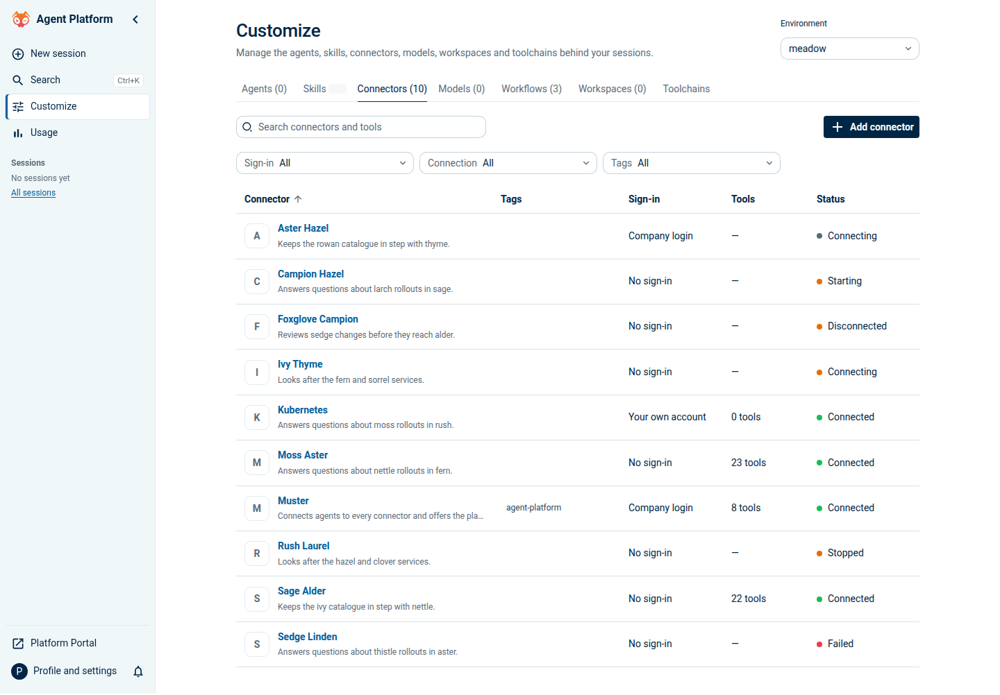
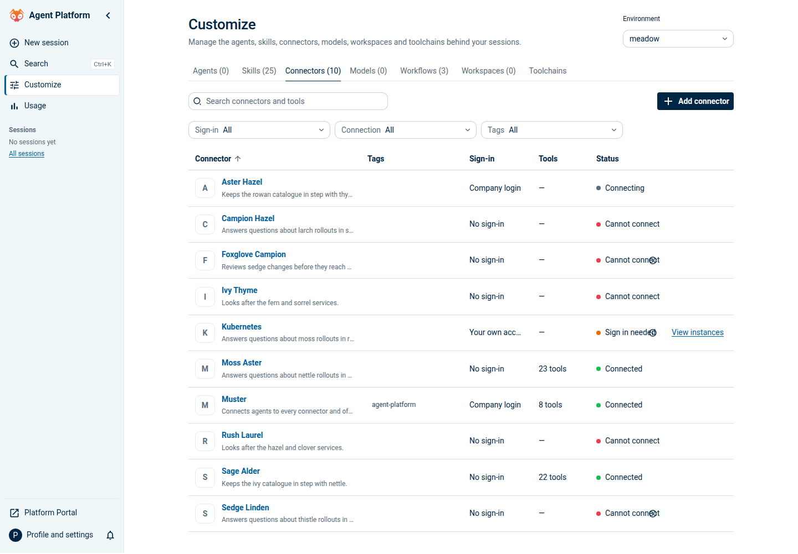
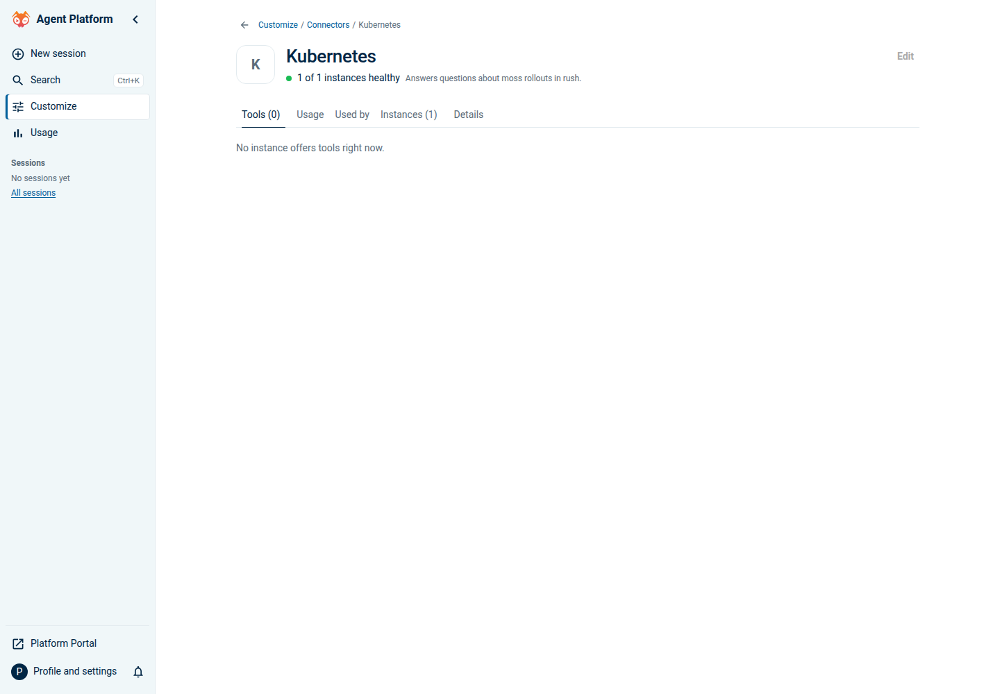
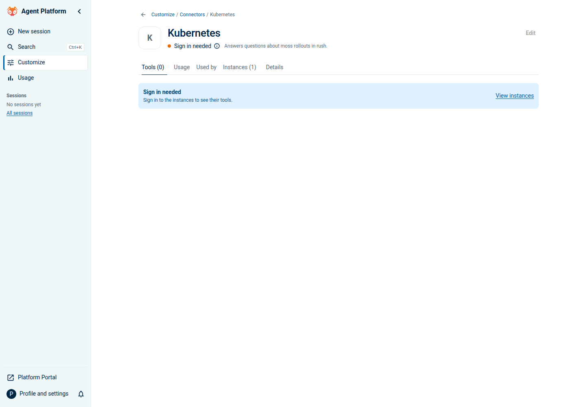
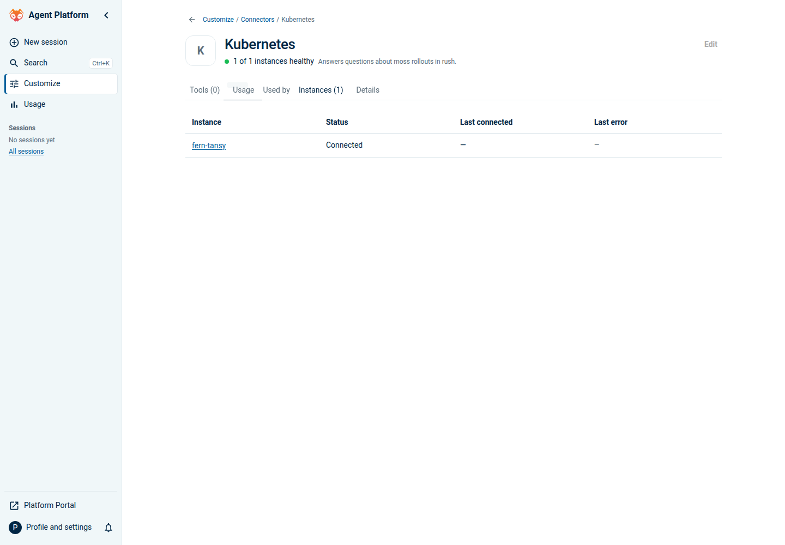
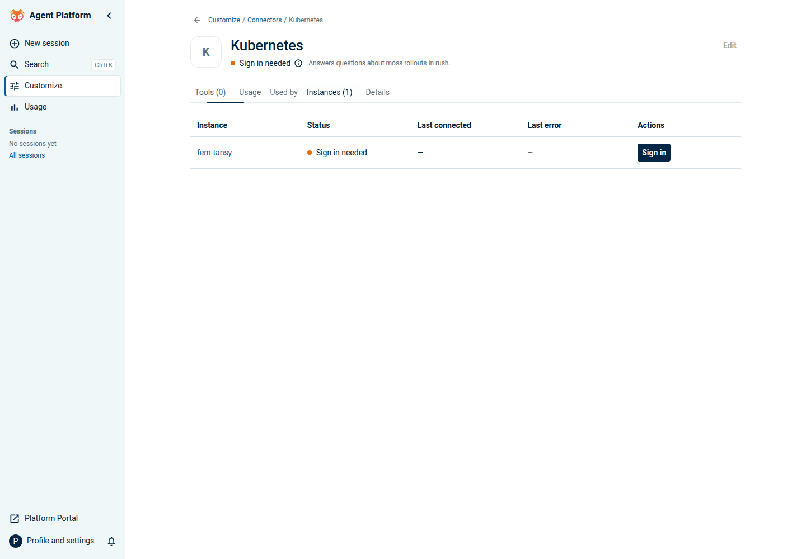
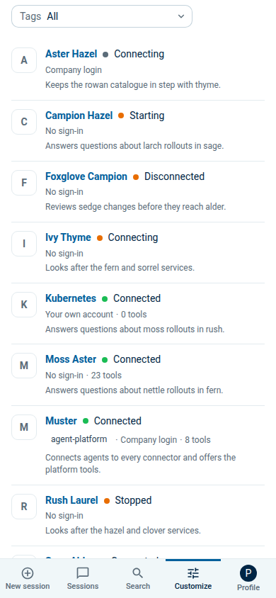
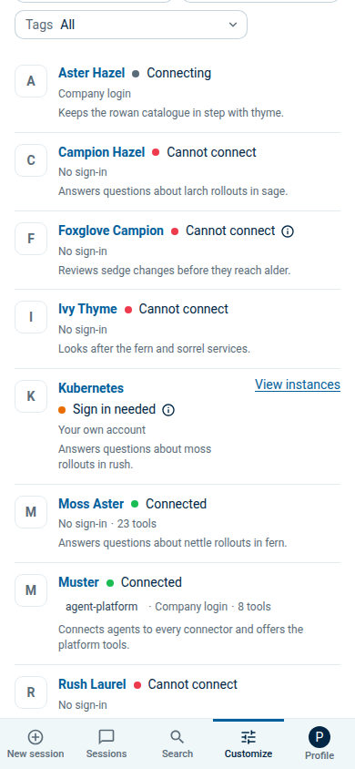

# Connector personal access comparison

These browser captures compare base commit `3b65ce455` with this branch using
the same fixture data. They reproduce the confirmed family-status defect,
not the original lab session from giantswarm/giantswarm#39138.

The fixture's OAuth connector is grouped into the `kubernetes` family and
displayed as Kubernetes. Its CR reports Connected, while its personal auth
status reports `auth_required` and its catalogue contains no tools. These
scenario changes are local to the capture and are not shipped in the fixture
API. Other rows use the normal generated data.

Desktop captures use 1440 × 1000. Phone captures use 390 × 844, scrolled to the
affected connector. Both recovery links were exercised in the browser and
reached the family's Instances tab; the desktop instance exposes Sign in.

| View       | Before                                      | After                                     |
| ---------- | ------------------------------------------- | ----------------------------------------- |
| Connectors |  |  |
| Tools      |            |            |
| Instances  |    |    |
| Phone      |           |           |
